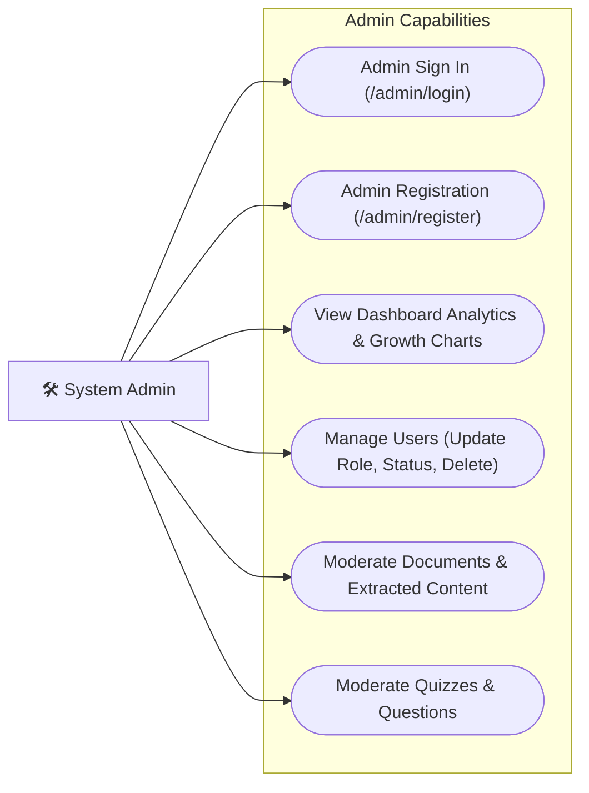
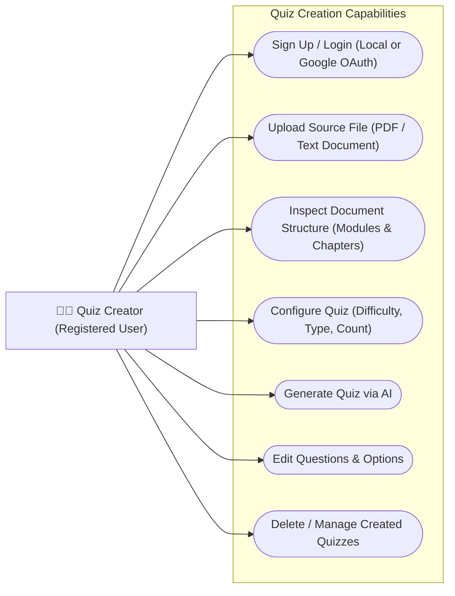
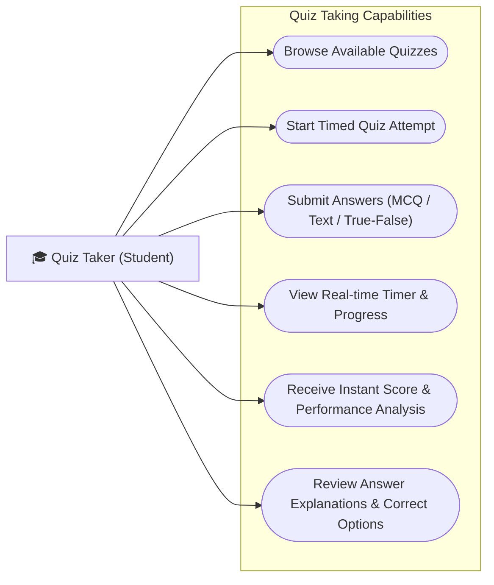
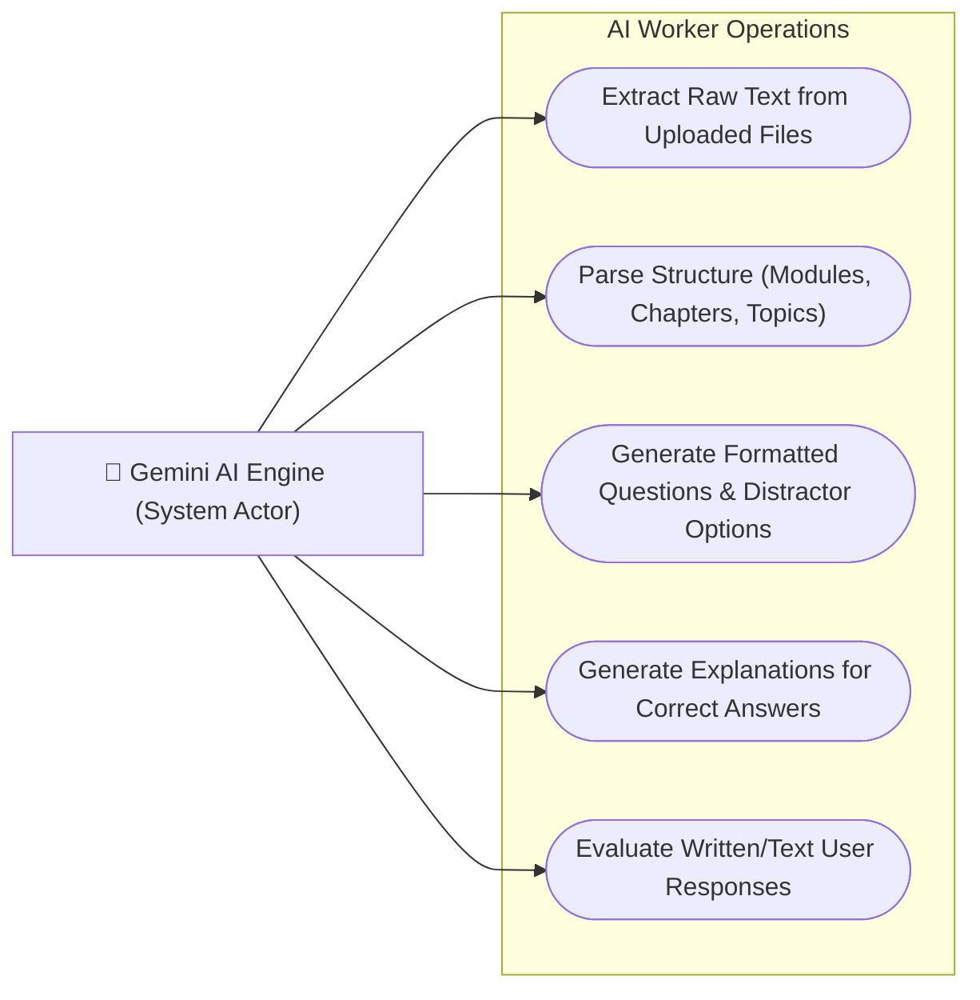

# QuestAI - Actor Use-Case Diagrams

This document contains detailed Use Case Diagrams for each of the 4 primary actors of the QuestAI system.

---

## 1. Admin Use-case Diagram
The Admin manages users, moderates generated quizzes/documents, views platform-wide metrics, and manages system configurations.

- **[View Admin Use-case SVG](file:///d:/sem%203%20project%20AI%20powered%20quiz%20generator/questai_admin_usecase.svg)**

---

## 2. Quiz Creator Use-case Diagram
The Quiz Creator (Registered User) uploads documents or source text and configures AI parameters to generate and edit quizzes.

- **[View Quiz Creator Use-case SVG](file:///d:/sem%203%20project%20AI%20powered%20quiz%20generator/questai_creator_usecase.svg)**

---

## 3. Quiz Taker Use-case Diagram
The Quiz Taker (Student / Candidate) browses quizzes, completes timed quiz attempts, and reviews answer explanations.

- **[View Quiz Taker Use-case SVG](file:///d:/sem%203%20project%20AI%20powered%20quiz%20generator/questai_taker_usecase.svg)**

---

## 4. AI Engine Use-case Diagram
The AI Engine is the automated system actor (Gemini API / FAST_UPLOAD_MODE) that handles layout extraction, question generation, and grading explanations.

- **[View AI Engine Use-case SVG](file:///d:/sem%203%20project%20AI%20powered%20quiz%20generator/questai_ai_engine_usecase.svg)**

