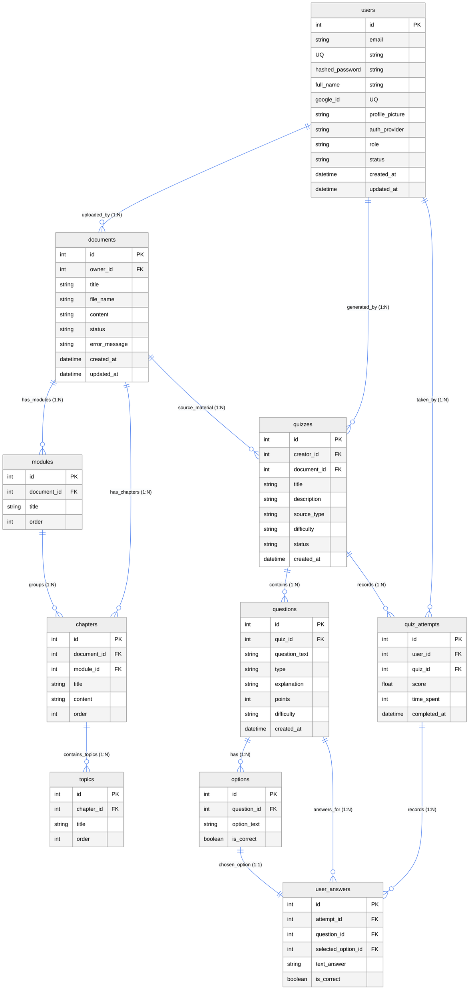

# QuestAI - Entity Relationship Diagram (ERD)

This document provides visual and interactive representations of the complete **10-table database schema** for the QuestAI quiz generator project on a clean **White Background**.

## 1. Interactive 10-Table White-Theme Mermaid Diagram

---

## 2. White-Background Vector ERD Diagram

The SVG vector diagram renders all **10 entity tables** on a **pure white canvas (`#ffffff`)**:

- **[View Pure White Background ERD Vector Diagram (SVG)](file:///d:/sem%203%20project%20AI%20powered%20quiz%20generator/erd_diagram.svg)**

