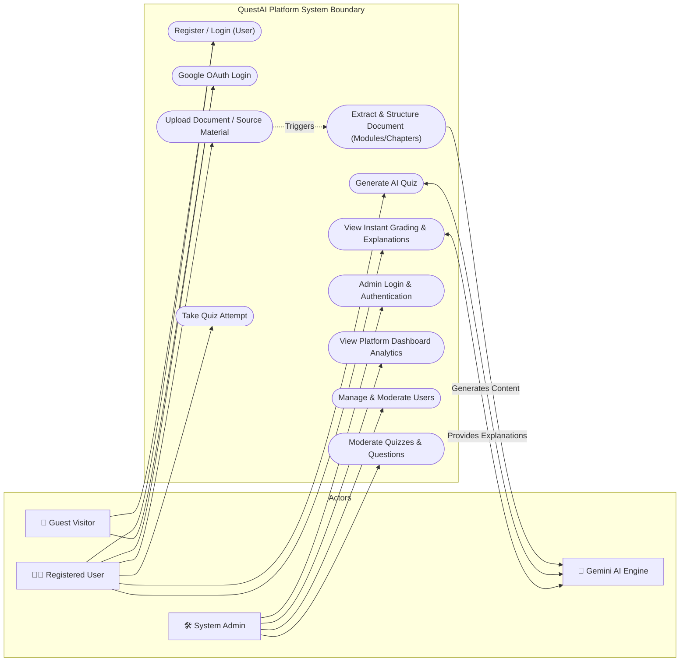

# QuestAI - System Use-Case Diagram

This document outlines the system boundary, user roles (actors), and their respective actions (use cases) within the QuestAI quiz generator application.

## 1. Actors Definition

- **Guest / Visitor**: Unauthenticated users exploring the landing page, register processes, or public features.
- **Registered User**: Logged-in users who upload source materials, generate and attempt quizzes, and manage performance metrics.
- **Admin**: System administrators who manage users, configure systems, moderate generated content, and view overall analytics.
- **AI Engine (System Actor)**: Automated background service (Gemini AI API) that parses document text, generates questions, and provides answer explanations.

---

## 2. Interactive Mermaid Use-Case Diagram

---

## 3. Visual Diagram Assets

### Vector Diagram (SVG)
- **[View QuestAI UML SVG Diagram](file:///d:/sem%203%20project%20AI%20powered%20quiz%20generator/questai_usecase_diagram.svg)**

---

### High-Resolution Rendered Layout (JPG)
Below is the rendered image showing the visual use case layout:

